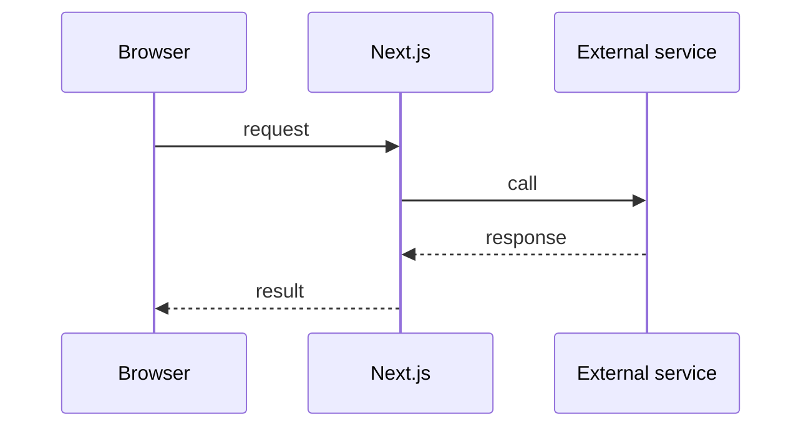

# <Flow name>

> Last verified against code: YYYY-MM-DD

## Purpose

One or two sentences: what this flow achieves and for whom.

## Systems involved

| System | Role in this flow | Source of truth for |
| --- | --- | --- |
|  |  |  |

## Business view

What happens, in plain language a non-engineer can follow. Include the rules that matter to the business.

## Step by step

1. 
2. 

## Diagram

## API contracts

Endpoints, methods, request and response shapes, headers, and authentication. One subsection per endpoint.

## Error handling

| Failure | Behavior | Retried? |
| --- | --- | --- |
|  |  |  |

State timeouts, what the user sees, and whether the call is idempotent.

## Gotchas

Things that have surprised people, one per line.

## Code map

| File | Responsibility |
| --- | --- |
|  |  |

## How it is tested

Unit, integration and E2E coverage, and the manual checks that remain.
